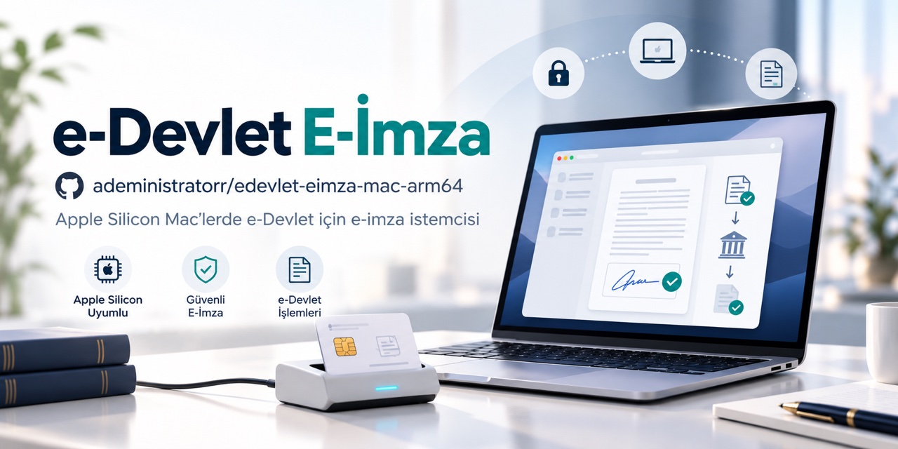

# Mac'tte e-Devlet e-imza kurulumu — Apple Silicon

> **Kısa yanıt:** e-Devlet Kapısı'nda elektronik imzayla giriş yapmak veya belge imzalamak istiyor ancak Mac'inizde imza uygulaması açılmıyor mu? Bu proje, Türksat'ın resmî e-Devlet e-imza istemcisini (`elektronik-imza.jar`) **MacBook, MacBook Pro, MacBook Air, Mac mini ve iMac**'de (Apple Silicon / M serisi / ARM tabanlı işlemci) çalışacak şekilde paketler: gömülü arm64 Java 11, Rosetta veya ayrı Java kurulumu gerekmez. **Gayriresmî bir topluluk çalışmasıdır; e-Devlet Kapısı veya Türksat tarafından hazırlanmış/onaylanmış bir uygulama değildir.**

## İlk kez kuranlar için

1. **Kart ve sürücü:** e-imza kartınızı, kart okuyucunuzu ve **arm64 AKİS sürücüsünü** hazırlayın: [akiskart.bilgem.tubitak.gov.tr/destek](https://akiskart.bilgem.tubitak.gov.tr/tr/destek/) → "Mac OS Arm (Apple Silicon)". Kontrol: `lipo -archs /usr/local/lib/libakisp11.dylib` çıktısı `arm64` içermeli.
2. **En kolay kurulum:** [Releases](../../releases) sayfasındaki güncel `EdevletEimza-arm64-*.dmg` dosyasını indirip uygulamayı Applications'a sürükleyin. Homebrew isteğe bağlıdır: `brew install --cask adeministratorr/tap/edevlet-eimza`.
3. **Başarılı kurulum nasıl anlaşılır?** Uygulamayı açtığınızda imza/PIN penceresi gelir; e-Devlet'teki imzalama akışı "imzalama aracı açık mı?" hatası vermeden ilerler.
4. **Sık hata:** "Akıllı Kart Bulunamadı" → sürücü eksik veya Intel sürücü kurulu. Gatekeeper uyarısı → DMG notarize olduğu için normal açılır; kaynaktan derlenen `.app` ad-hoc imzalıdır, gerekirse sağ tık → **Aç**.
5. **Önemli sınır:** Uygulama yalnızca **arm64** (Apple Silicon) içindir; Intel Mac desteklenmez. Bu depoda kart erişimi **AKİS** ile doğrulanmıştır; diğer kart/okuyucu kombinasyonları test edilmemiştir. İmza PIN'inizi hiçbir komuta, issue'ya veya kişiye yazmayın.

> **Güvenlik notu:** Bu paket resmî kurum uygulaması değildir; üçüncü taraf dağıtımıdır. `kur.sh` betiğini çalıştırmadan önce içeriğini inceleyin. DMG sürümü Developer ID ile imzalı ve Apple notarizasyonundan geçmiştir; sürüm notlarında `sha256` bulunur. Ad-hoc imza, notarizasyon değildir.

## Kimler için?

Avukatlar, mali müşavirler (SMMM/YMM), doktorlar ve sağlık profesyonelleri, mühendis ve mimarlar, eczacılar, gümrük müşavirleri, şirket yetkilileri (MERSİS), kamu çalışanları, EKAP/ihale kullanıcıları ve e-imza kartı olan tüm Mac kullanıcıları.

## "Mac'te e-imza çalışmıyor" arayanlar için kısa cevaplar

- **Neden Mac'te sorun çıkıyor?** Uygulama Java Web Start (JNLP) tabanlı dağıtılıyordu; Java Web Start Java 11 ve sonrasında kaldırıldı. Bu paket, uygulamayı gömülü Java 11 ile native `.app`'e çevirir ve arm64 kart erişimi için gereken yamayı uygular.
- **MacBook / MacBook Pro / MacBook Air / iMac / Mac mini'de çalışır mı?** Evet — Apple Silicon (M1/M2/M3/M4 ve sonrası) modeller destekli. Intel Mac desteklenmez.
- **Rosetta veya Java kurmam gerekir mi?** Hayır; paket ARM native (arm64) ve Java uygulamaya gömülüdür.
- **İmza için ek olarak ne gerekir?** e-imza kartı + kart okuyucu + **arm64 AKİS sürücüsü** (yukarıda).
- **macOS 28 / Rosetta uyarısı alırsam?** Uyarı e-Devlet uygulamasından değil, eski **Intel** AKİS paketinden (`/Applications/Akia.app`) gelir — çözüm aşağıdaki bölümde.

## Neden Mac'te çalışmıyordu? Nasıl çözdük?

- **Sorun:** e-Devlet E-İmza istemcisi modern Mac'lerde kurulamıyor/açılamıyordu.
- **Neden:** Uygulama Java Web Start (JNLP) ile dağıtılıyordu; Java Web Start Java 11 ile kaldırıldı. Ayrıca kart erişimini sağlayan IAIK katmanında arm64 (connect) sorunu vardı ve jar güncellenince eski yama betiği hata veriyordu.
- **Çözüm:** `jpackage` + gömülü **arm64 Java 11** ile native `.app` paketleme; IAIK arm64 connect-fix yaması; jar artık uyumlu sınıflar içerdiğinde yamanın hata vermeden atlanıp `javap` doğrulamasıyla devam etmesi (bu depodaki düzeltme — aşağıda).

## Kurulum (3 yol)

1. **Hazır DMG (en hızlı):** [Releases](../../releases) → `EdevletEimza-arm64-*.dmg`; uygulamayı Applications'a sürükleyin.
2. **Homebrew:**

```bash
brew install --cask adeministratorr/tap/edevlet-eimza     # hazır DMG
brew install adeministratorr/tap/edevlet-eimza            # kaynaktan derler
```

3. **Tek satır (kaynaktan derler; betiği önce inceleyin):**

```bash
curl -fsSL https://raw.githubusercontent.com/adeministratorr/edevlet-eimza-mac-arm64/main/kur.sh | bash
```

Diğer araçlar (aynı tap): [PTT KEP Webmail](https://github.com/adeministratorr/pttkep-eimza-mac-arm64) · [PTT UETS / e-Tebligat](https://github.com/adeministratorr/uets-eimza-mac-arm64) · [TNB Teknoloji İmza](https://github.com/adeministratorr/tnb-eimza-mac-arm64) · [UHAP İmzalama](https://github.com/adeministratorr/uhap-eimza-mac-arm64) · [UDF QuickLook](https://github.com/adeministratorr/udf-quicklook-extension) · [UYAP Doküman Editörü](https://github.com/adeministratorr/ude-mac-arm64-1)

---

## Bu depodaki düzeltme (fix)

Bu depo **Said Sürücü**'nün https://github.com/saidsurucu/edevlet-eimza-mac-arm64 projesine dayanır; asıl teorik çalışma (JNLP → jpackage hattı, Java 11 gömme, IAIK arm64 connect-fix patch'i) ona aittir. Bu sürüm küçük bir bakım düzeltmesiyle ayrılıyor:

- `scripts/build.sh > patch_jar`: patcher üstten hiç `.class` üretmediyse (`work/out` yok) bu, jar'ın **zaten uyumlu** olduğu anlamına gelir (Türksat jar'ı artık sürüm-uyumlu sınıflar içeriyor). Eski betik bu durumda `patcher hiç .class üretmedi` hatasıyla `all`'u hata veriyordu. Artık bu durumda patch atlanıp `javap` doğrulaması ile devam eder.
- Standart `kur.sh` ve `scripts/build.sh` davranışları aynen korunur.

## ⚠️ macOS 28 / Rosetta uyarısı alırsanız (eski Intel AKİS paketi)

macOS, sistemde **eski Intel AKİS paketi** kuruluyken "bu uygulama Intel tabanlıdır; gelecek macOS sürümünde açılmayacak" uyarısı gösterir (Mac'lerde Rosetta desteği macOS 28'de kaldırılıyor). Uyarı e-imza uygulamalarından değil, AKİS'in Intel sürümünün kurduğu `/Applications/Akia.app`'ten gelir.

- **Teşhis:** `lipo -archs /Applications/Akia.app/Contents/MacOS/Akia` → `x86_64` ise eski Intel paketi kurulu.
- **Çözüm:** [TÜBİTAK'ın **Mac OS Arm (Apple Silicon)** paketini](https://akiskart.bilgem.tubitak.gov.tr/tr/destek/) kurun — yeni sürüm `Akia ARM.app` (arm64) olarak gelir. Eski `/Applications/Akia.app`'i Finder'da Çöp'e sürükleyin (Terminal'den: `sudo rm -rf /Applications/Akia.app && sudo pkgutil --forget tr.gov.tubitak.akia`).
- **Kritik olan sürücüdür:** `lipo -archs /usr/local/lib/libakisp11.dylib` → `x86_64 arm64` (en az `arm64`) olmalı. E-imza akışları Akia.app'e **bağlı değildir**; kart erişimi bu dylib üzerinden yürür (gerçek kart + PIN ile doğrulandı).

## Gereksinimler

- macOS Apple Silicon (arm64) — MacBook, MacBook Pro, MacBook Air, Mac mini, iMac
- Komut satırı araçları (betik Xcode CLT kurulmasını kendisi ister)
- TÜBİTAK AKİS sürücüsü — **Apple Silicon (Arm) paketi** (Intel paketini kurmayın; bkz. yukarıdaki macOS 28 notu): https://akiskart.bilgem.tubitak.gov.tr/tr/destek/
- e-imza kartı okuyucu + e-imza kartı

## Not

Resmî kaynak jar: https://static.turkiye.gov.tr/downloads/e-imza/edevlet-eimza.jnlp
